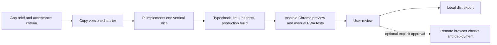

# PWA factory: research and recommendation

## Goal
A small, repeatable PWA development workflow driven by Pi on Android/Termux.
Prioritize useful, responsive, good-looking, offline-capable apps over orchestration complexity.
Research only so far; the proposed factory is not installed or implemented.

## Source projects

### OpenSpec — lightweight change records
https://github.com/Fission-AI/OpenSpec
Reviewed upstream README. Uses per-change proposal, specs, design and tasks with an archive after completion. Node CLI requires Node >=20.19; our Node is 24.18.0, but actual Android compatibility and Pi integration are not verified.
Borrow: a small change folder with acceptance scenarios and an implementation checklist.
Avoid importing its CLI unless it saves more effort than plain Markdown.

### GitHub Spec Kit — explicit requirements and verification
https://github.com/github/spec-kit
Reviewed README and search results. Spec-first development with planning/task artifacts and multiple agent integrations.
Borrow: an explicit definition of done and a short project constitution.
Not recommended as a mandatory dependency for v1: additional tooling/process for small personal apps.

### Context Engineering Intro — context and validation loops
https://github.com/coleam00/context-engineering-intro
Reviewed README. Feature briefs, contextual references, PRP templates and validation commands.
Borrow: point the agent at specific files and executable checks rather than relying on chat history.
Adapt Claude-oriented instructions to Pi rather than installing them unchanged.

### Vite PWA scaffolder — app template foundation
https://github.com/vite-pwa/create-pwa
Reviewed README. React/TypeScript and other templates, PWA integration, update prompts, offline shell support.
Borrow: a small Vite React TypeScript starter with installable manifest, real icons, explicit service-worker update policy.
Validate dependencies on Android: native npm dependencies may need Termux-specific handling.

### shadcn/ui and Tweakcn — consistent visual system
https://github.com/shadcn-ui/ui
https://github.com/jnsahaj/tweakcn
Already downloaded as reference snapshots in ~/storage/downloads/pwa-resources/.
Borrow: editable controls, semantic tokens and a single coherent theme.
Do not copy entire reference repositories or node_modules into each generated app.

### Vitest and fake-indexeddb — phone-friendly data tests
https://github.com/vitest-dev/vitest
https://github.com/dumbmatter/fakeIndexedDB
Candidates for Node-based logic/storage tests. Compatibility must be confirmed by running a sample on this phone.
Mocks do not validate service-worker behavior or actual browser persistence.

### Playwright and Lighthouse CI — browser quality gates
https://github.com/microsoft/playwright
https://github.com/GoogleChrome/lighthouse-ci
https://playwright.dev/docs/browsers
https://playwright.dev/docs/api/class-android
Standard Playwright browser installation is not officially supported on Android/Termux.
Android automation is experimental; do not assume it works locally.
Use Chrome on this phone for manual install/offline/update tests.
Optionally run browser automation and Lighthouse on GitHub Actions or the user's Mac.
A skipped browser check must remain visibly unverified, not count as a pass.

## Recommended minimal factory
One reviewed starter, one generator, a few Pi prompt templates, executable checks and durable per-app state.
No Docker, Python/uv dependency or autonomous multi-agent swarm required.

## Proposed workflow (not existing commands)
- /pwa-new: clarify the brief and generate a new app, refusing to overwrite existing directories.
- /pwa-feature: implement one scoped change and run the checks.
- /pwa-check: run checks, record evidence and distinguish PASS, FAIL and UNVERIFIED.
- /pwa-release: export dist only after applicable gates pass; deployment requires approval.

Prompt templates are instructions, not a security boundary. Shell/npm checks must enforce failures and nonzero exits.

## Proposed layout
~/pwa-factory/
  research/
  templates/mobile-pwa/
  scripts/
  prompts/
  apps/<name>/
  README.md

Each app: brief.md, AGENTS.md, design tokens, src/, tests/, lockfile and a verification report.
Projects live on Termux private storage. Only deliberate exports go to Downloads.

## Gates
1. Fresh scaffold installs and builds on this actual phone.
2. Typecheck, lint and unit tests pass; tests exercise the main user flow and local data behavior.
3. Static validation confirms manifest/icons and production service-worker artifacts exist.
4. Manual Chrome tests: 360px layout, touch controls, keyboard, dark mode, offline after initial load, data after reload and safe updates.
5. Optional remote: Playwright/axe and Lighthouse with recorded environment and budgets.
6. Never publish, upload app data, delete user files or install third-party skills silently.

## Open decisions
- CLI plus Pi commands versus a local browser dashboard.
- Fully local workflow versus optional remote CI/deployment.
- First real app to serve as an end-to-end acceptance test.

## Connections
- [[../README.md]]
